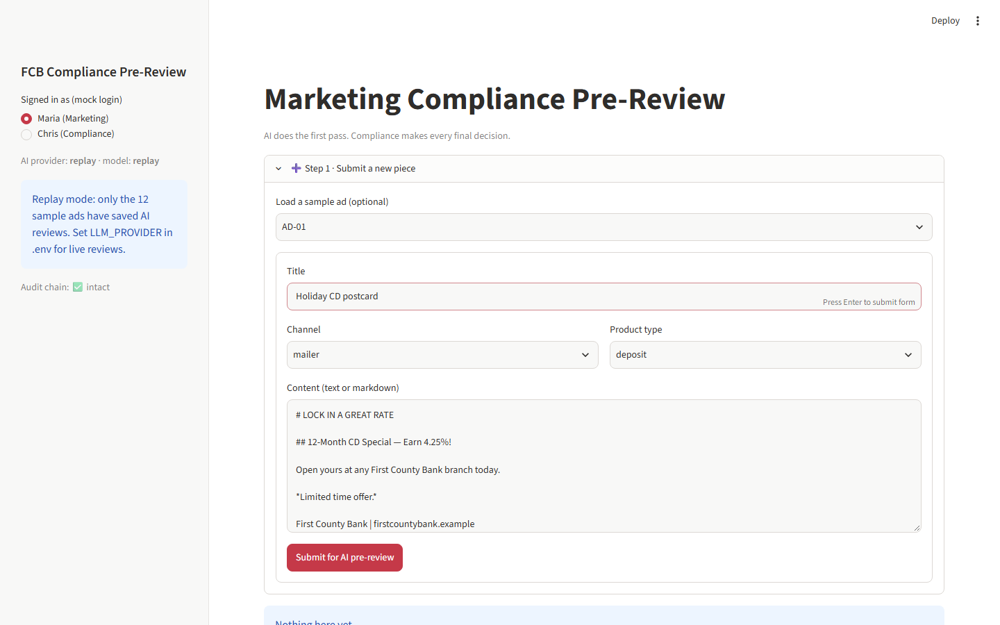
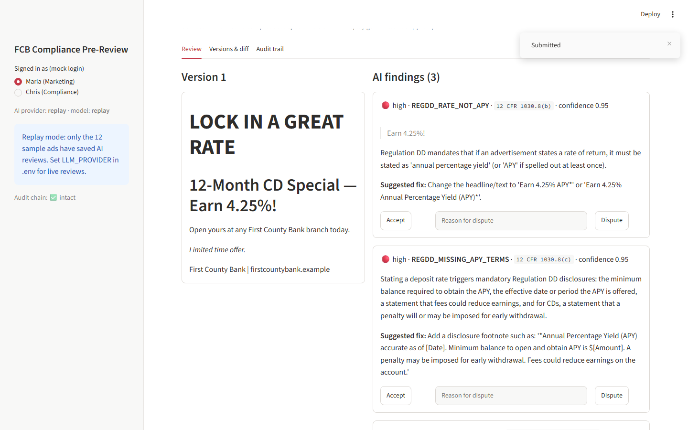
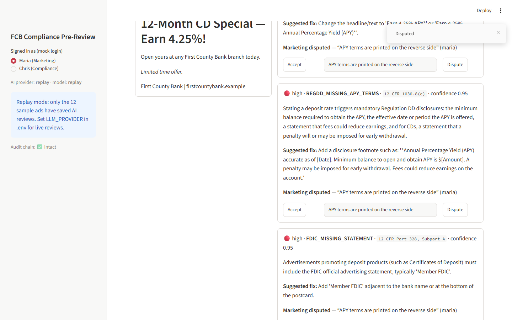
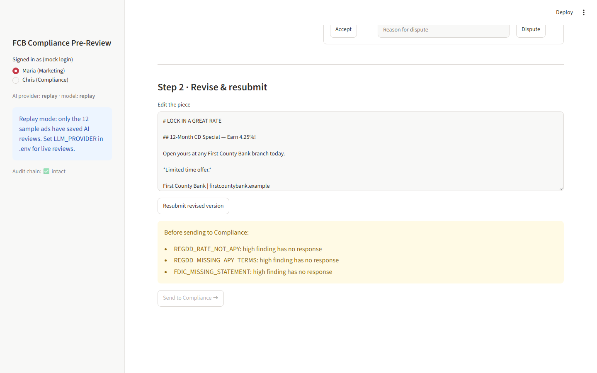
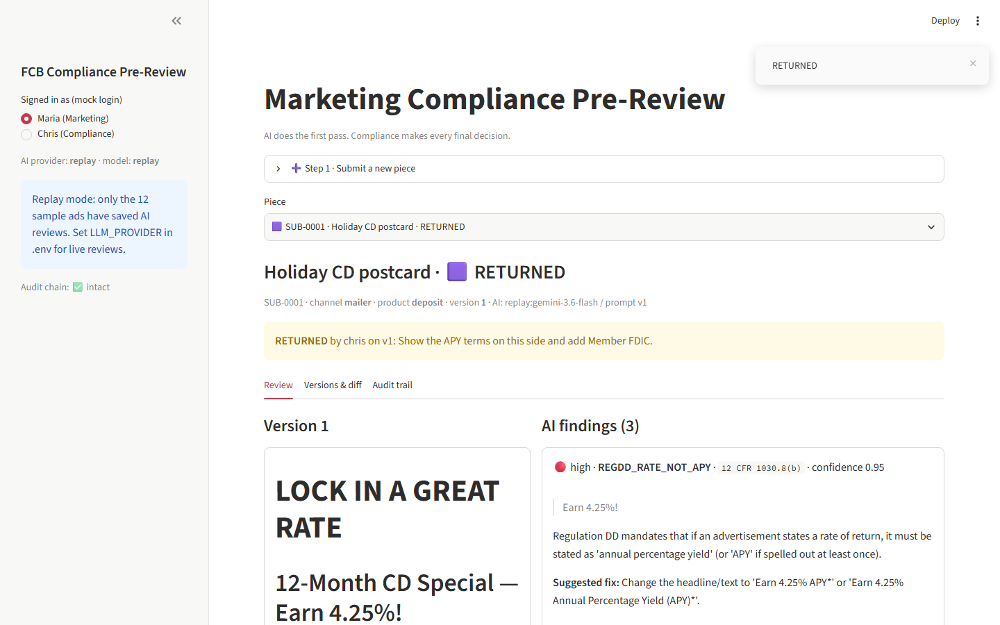
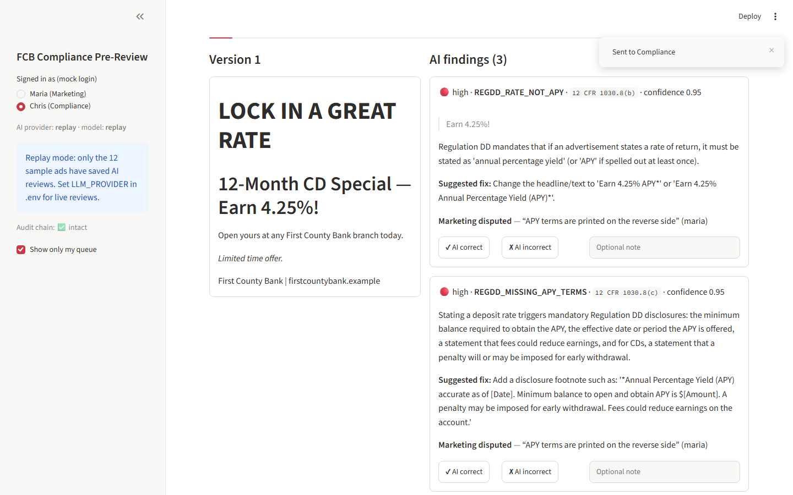
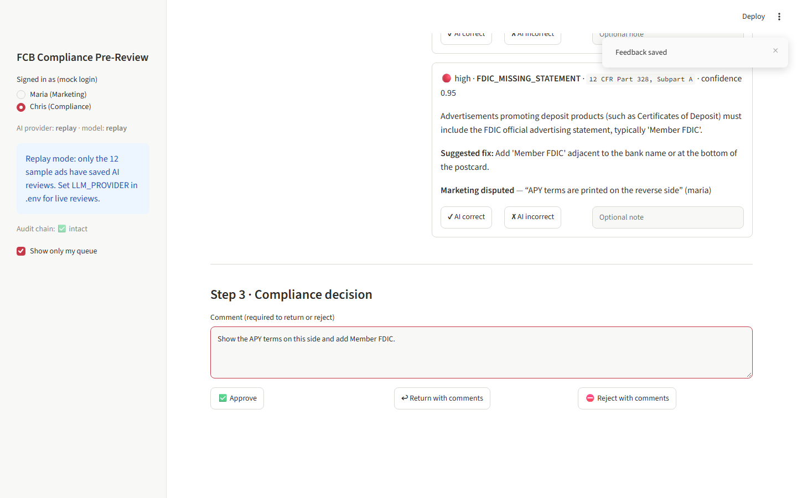
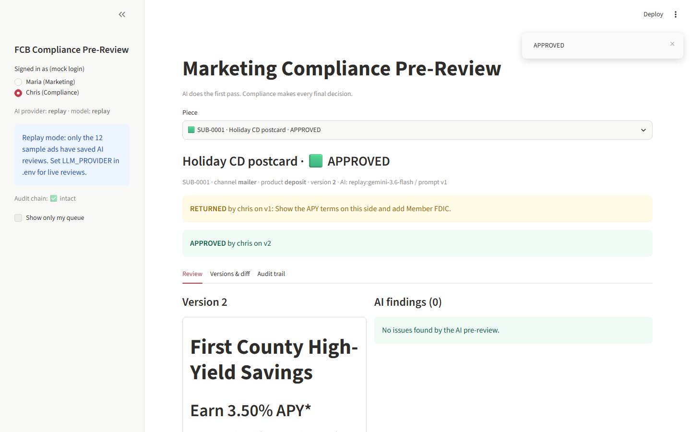
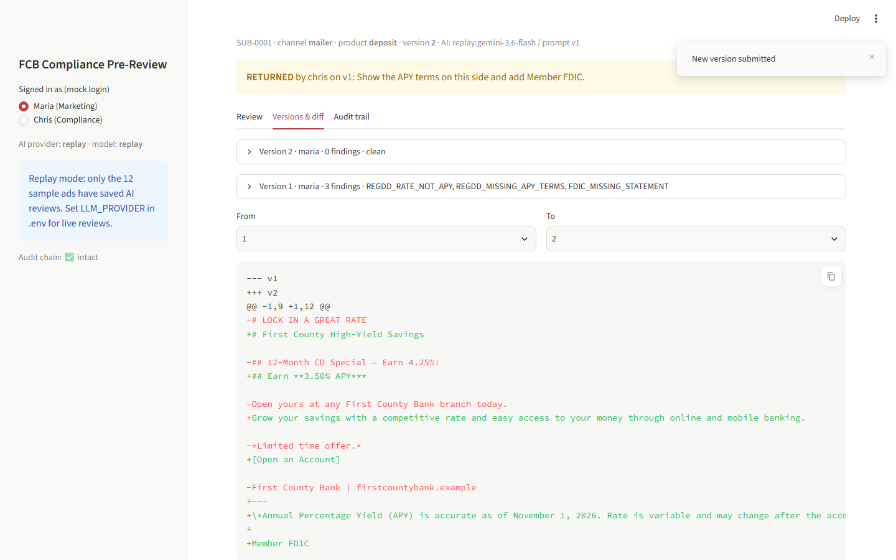
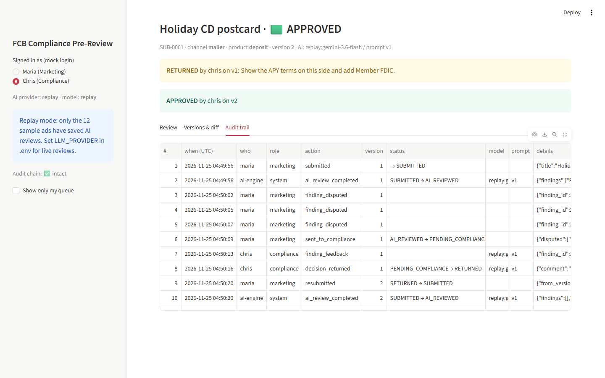

# User Manual — Marketing Compliance Pre-Review

This app gives every marketing piece an **AI first-pass compliance review** before it reaches Compliance.
The AI flags likely problems with federal advertising rules; **Marketing** fixes or disputes them; **Compliance**
makes the final decision. The AI never approves anything.

To install and start the app, see [Run Instructions](run_instructions.md).

---

## 1. Who does what

| Role | In the app | Can | Cannot |
| --- | --- | --- | --- |
| **Marketing** | Maria (Marketing) | Submit pieces, accept or dispute AI findings, revise and resubmit, send to Compliance | Approve, return or reject; rate AI findings |
| **Compliance** | Chris (Compliance) | Review pieces, mark AI findings correct/incorrect, approve, return with comments, reject with comments | Edit a piece, submit, accept or dispute findings |

**Signing in:** this prototype uses a mock login. Choose your role in the left sidebar under
**Signed in as (mock login)**. There are no passwords.

## 2. How a piece moves through review

```
SUBMITTED ──AI review──▶ AI_REVIEWED ──Send to Compliance──▶ PENDING_COMPLIANCE ──▶ APPROVED
                          ▲      │  (only when every                       │──▶ REJECTED (with comment)
                          │      │   high finding is handled)              │
                          │      └─ Resubmit (new version, new AI review)  │
                          └──────── RETURNED (with comment) ◀──────────────┘
```

| Status | Meaning | Whose turn |
| --- | --- | --- |
| 🟦 SUBMITTED | Waiting for the AI review (or the AI review failed and can be retried) | System / Marketing |
| 🟨 AI_REVIEWED | AI findings are ready | Marketing |
| 🟧 PENDING_COMPLIANCE | Sent to Compliance | Compliance |
| 🟪 RETURNED | Compliance sent it back with comments | Marketing |
| 🟩 APPROVED | Final: can be published | — |
| 🟥 REJECTED | Final: cannot be published | — |

APPROVED and REJECTED are final; the piece cannot be changed afterwards.

---

## 3. Marketing guide

### Step 1 — Submit a piece

1. Sign in as **Maria (Marketing)**.
2. Open **➕ Step 1 · Submit a new piece**.
3. Optional: pick a sample from **Load a sample ad** (AD-01 to AD-12) to fill the form.
4. Enter a **Title**, choose the **Channel** (email, social, web, print, radio, mailer) and **Product type**
   (deposit, loan, mortgage, credit card, investment, general), and paste the text into **Content**.
   Plain text or markdown both work.
5. Click **Submit for AI pre-review**. The AI review takes a few seconds.



The piece gets an ID (for example `SUB-0001`) and moves to **AI_REVIEWED**.

### Step 2 — Read the AI findings

Your piece is shown on the left and the AI findings on the right. Each finding card shows:

| Part | Meaning |
| --- | --- |
| 🔴 high / 🟠 medium / ⚪ low | How serious the issue is |
| Issue code (e.g. `REGDD_RATE_NOT_APY`) | The type of problem |
| Citation (e.g. `12 CFR 1030.8(b)`) | The regulation it comes from |
| Confidence | How sure the AI is (0–1) |
| ⚠️ *low confidence — needs human judgment* | Shown when confidence is below 0.6; treat it as a question, not a verdict |
| Quoted text | The exact words that triggered it (absent when something is **missing**) |
| Explanation and **Suggested fix** | Why it matters and what to change |



If the AI finds nothing, you see **"No issues found by the AI pre-review."**

### Step 2 — Respond to each finding

For each finding, either:

- **Accept**: you agree and will fix it. Then edit the text and resubmit (below).
- **Dispute**: you disagree. Type a short reason in the box first (for example, "APY terms are printed on the
  reverse side"), then click **Dispute**. A dispute without a reason is not accepted.

You can change your mind; the latest response counts, and every response is kept in the audit trail.



### Step 2 — Revise and resubmit

1. Scroll to **Step 2 · Revise & resubmit** and edit the text in **Edit the piece**.
2. Click **Resubmit revised version**.

This creates a new version (v2, v3, …) and runs a fresh AI review. Earlier versions are never overwritten;
compare them in the **Versions & diff** tab.

### Send to Compliance

**Send to Compliance ➜** stays disabled until every **high** finding on the current version is handled. The yellow
box lists what is still blocking:

| Message | What to do |
| --- | --- |
| *high finding has no response* | Accept it (and fix it) or dispute it with a reason |
| *accepted but not yet fixed; revise and resubmit* | Edit the text and resubmit; if the new version no longer triggers the finding, it is fixed |

Medium and low findings never block sending, but answering them helps Compliance.



### When a piece is RETURNED

Compliance's comment appears in a yellow banner at the top of the piece. Revise the text, resubmit, and send it
to Compliance again.



---

## 4. Compliance guide

1. Sign in as **Chris (Compliance)**. The **Piece** list shows your queue (pieces in PENDING_COMPLIANCE).
   Untick **Show only my queue** in the sidebar to see all pieces, including approved and rejected ones.
2. Review the final version (left) next to the AI findings and Marketing's responses (right).



### Rate the AI findings

On each finding, click **✔ AI correct** or **✘ AI incorrect**, with an optional note. This does not change the
piece's status. It records whether the AI was right, which is how the system is measured and improved over time.

### Make the decision

Under **Step 3 · Compliance decision**:

| Button | Comment | Result |
| --- | --- | --- |
| ✅ **Approve** | Optional | APPROVED (final) |
| ↩ **Return with comments** | **Required**: say what to fix | RETURNED to Marketing |
| ⛔ **Reject with comments** | **Required**: say why it cannot run | REJECTED (final) |



Every decision appears as a banner at the top of the piece, with who made it, on which version, and the comment.



---

## 5. Versions & diff

The **Versions & diff** tab lists every version with its author and AI findings. Choose **From** and **To** to see
exactly what changed: red lines were removed, green lines were added.



## 6. Audit trail

The **Audit trail** tab lists every action on the piece, oldest first: when (UTC), who, role, action, version,
status change, the AI model and prompt version used, and details such as dispute reasons and comments. Entries
cannot be edited or deleted.

The sidebar shows **Audit chain: ✅ intact**. Each entry is linked to the previous one by a hash; if anyone altered
the history, it would show **❌ broken** with the first altered entry.



---

## 7. Frequently asked questions

**The AI review failed. What now?**
The piece stays in SUBMITTED with the error shown. Click **Retry AI review**. If it keeps failing, the AI service
may be down or out of quota (see [Run Instructions → Troubleshooting](run_instructions.md#troubleshooting)).

**It says "Replay mode has no saved review for this exact text".**
The app is running in replay mode (no live AI). Only the 12 sample ads, exactly as provided, have saved reviews.
Ask your administrator to switch to a live AI provider to review new or edited text.

**Why can't I send to Compliance after accepting a finding?**
Accepting means "I'll fix it". Make the change and resubmit; the new AI review confirms the fix.

**Can I edit a piece after it is approved?**
No. Approved and rejected pieces are final. Submit a new piece instead.

**Does the AI decide whether the ad can be published?**
No. The AI only suggests findings. Only Compliance can approve.
